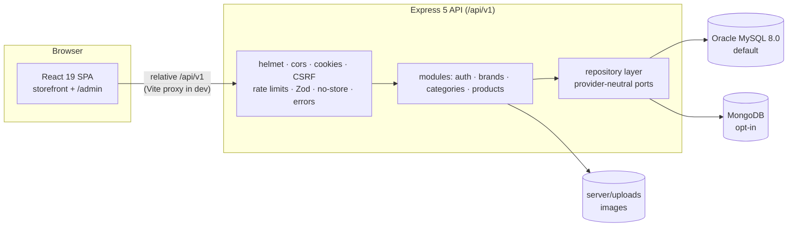
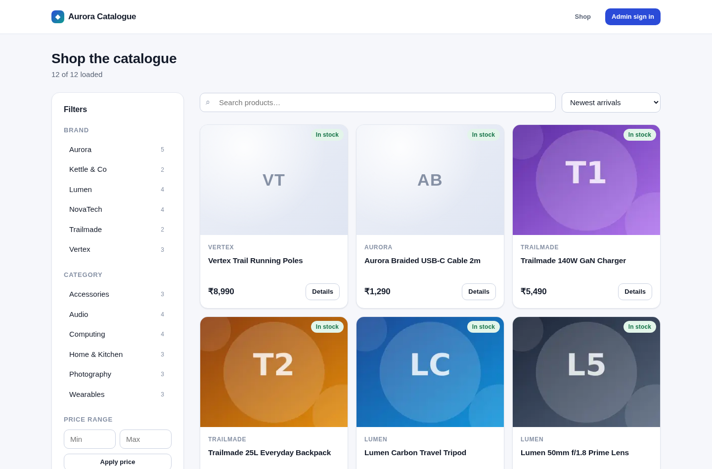
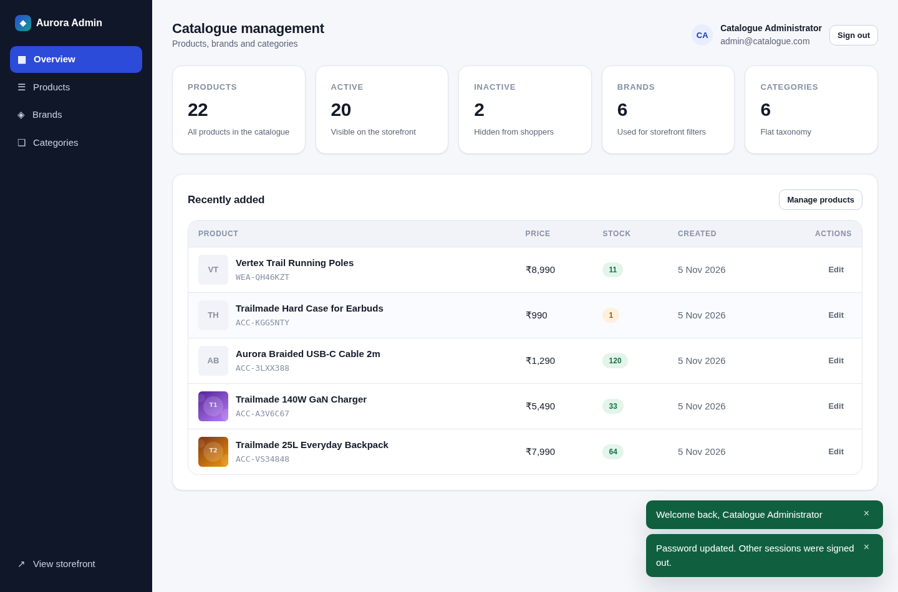
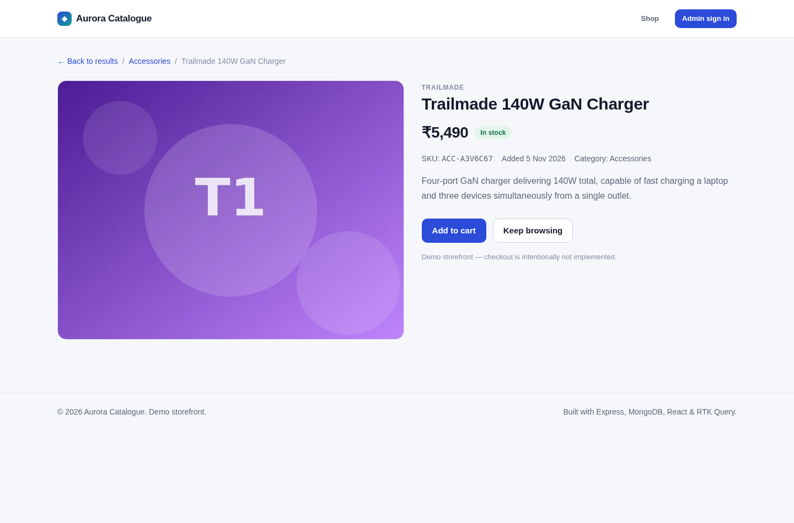
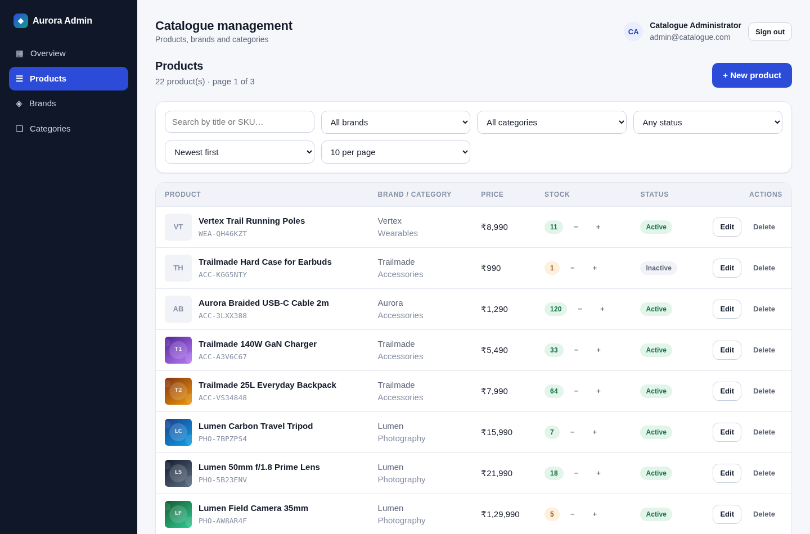
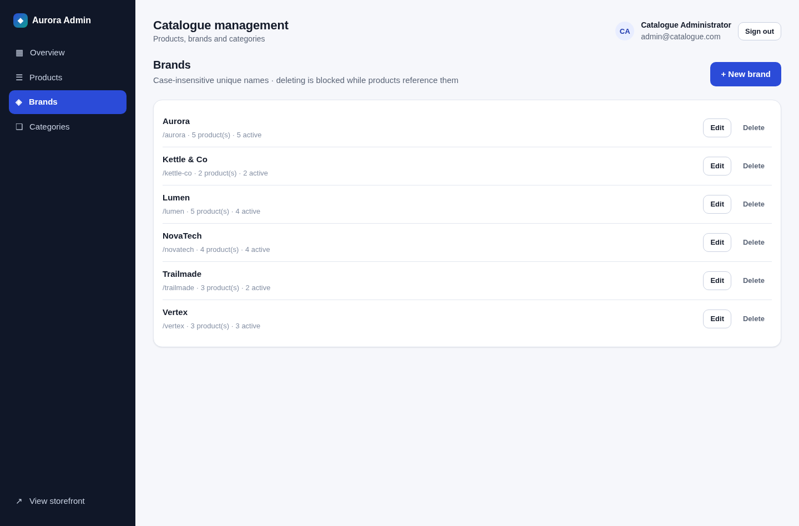
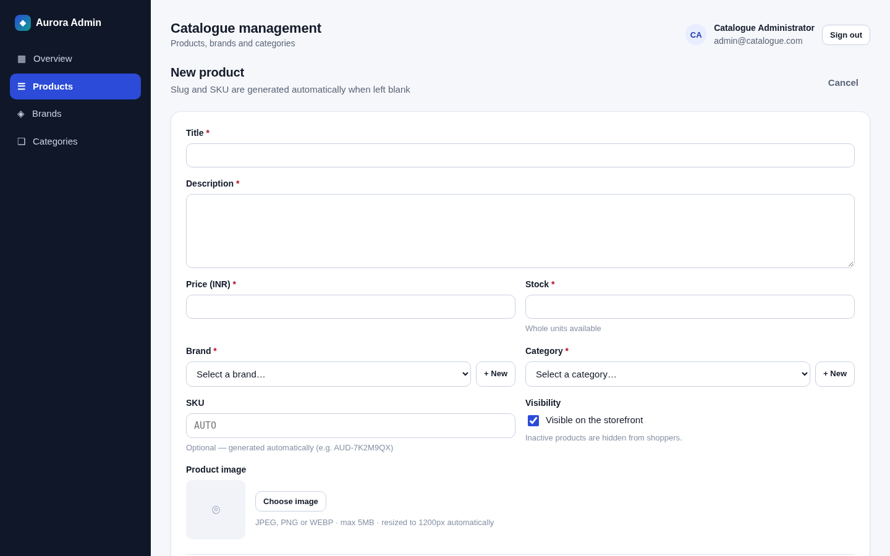
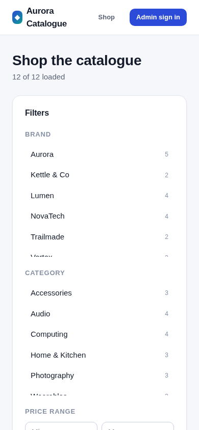
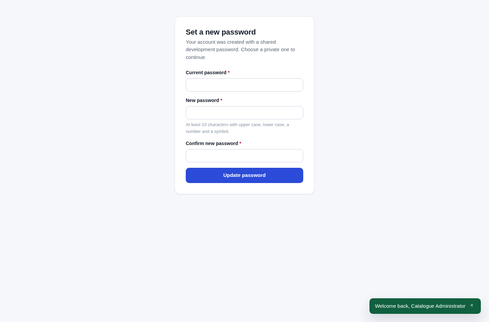

# Aurora Catalogue

A production-shaped **product catalogue platform**: an Express 5 REST API and a React 19
single-page app that serves a customer storefront and an administrative dashboard.

The interesting engineering is not the CRUD — it is that the same API and the same contract run
on **two different databases** (Oracle MySQL 8.0 by default, MongoDB on request) behind a
repository layer, with provider parity pinned by a golden API-contract snapshot. One deployable
API, one SPA, no microservices, no container requirement, no cloud dependency.

|                     |                                                                                                                                                                                    |
| ------------------- | ---------------------------------------------------------------------------------------------------------------------------------------------------------------------------------- |
| **Runtime**         | Node.js ≥ 22.22 · ESM everywhere (no transpiler on the server) · npm workspaces (`server`, `client`)                                                                               |
| **API**             | Express 5 · Zod 4 validation · Helmet · CORS (exact origin) · cookie-parser · express-rate-limit · Swagger UI                                                                      |
| **Data access**     | Repository Pattern with two interchangeable providers: **mysql2** (MySQL 8.0) and **Mongoose 9** (MongoDB) · canonical 24-hex identifiers · provider-neutral mappers               |
| **Auth & security** | JWT in an httpOnly cookie · signed double-submit CSRF · bcrypt hashes · login lockout · `token_version` session invalidation · forced password rotation · role-based authorisation |
| **Frontend**        | React 19 · Redux Toolkit 2 · RTK Query (single slice) · React Router 8 · Vite 8 (Rolldown)                                                                                         |
| **Styling**         | Hand-written CSS with design tokens — no UI kit, no CDN, no font service                                                                                                           |
| **Uploads**         | Multer + sharp: MIME sniffing, re-encode, 300 px thumbnail, metadata stripped                                                                                                      |
| **Testing**         | Vitest 5 · Supertest · mongodb-memory-server · React Testing Library · Playwright                                                                                                  |
| **Tooling**         | ESLint 9 (flat config, boundary rules) · Prettier 3 · GitHub Actions workflow (5 jobs)                                                                                             |

---

## Contents

- [Architecture](#architecture)
- [Features](#features)
- [Screenshots](#screenshots)
- [Quick start — Windows (PowerShell)](#quick-start--windows-powershell)
- [Quick start — macOS / Linux](#quick-start--macos--linux)
- [Choosing a database](#choosing-a-database)
- [Scripts](#scripts)
- [Project structure](#project-structure)
- [Testing and verification](#testing-and-verification)
- [Limitations and intentional exclusions](#limitations-and-intentional-exclusions)
- [Documentation](#documentation)
- [Project status](#project-status)

---

## Architecture



- **Modular monolith.** `server/src/modules/{auth,brands,categories,products}` each own their
  model, Zod schema, service, controller and router. `server/src/routes/index.js` is the only
  file that knows the URL layout, so modules cannot reach into each other's paths.
- **Provider-neutral domain code.** Services never import a driver. `repositories/` defines the
  ports; `repositories/mongo/*` and `repositories/mysql/*` implement them; shared mappers and a
  shared identifier contract keep the JSON byte-identical across both.
- **One data layer in the SPA.** Everything goes through `client/src/api/apiSlice.js`; Redux
  holds only what the server cannot own (session mirror, filter intent, table page tokens,
  toasts). A CSRF-aware `baseQuery` refreshes the token once and replays the request.
- **The URL is user state, the cache is internal state.** Filters and sort are mirrored into the
  URL both ways; how many pages are loaded is owned by the RTK Query cache and deliberately
  _not_ in the URL.

Full write-up, diagrams and the data model: **[`docs/architecture/ARCHITECTURE.md`](docs/architecture/ARCHITECTURE.md)**.

## Features

**Storefront**

- Product grid with **cursor pagination** (stable under concurrent inserts), "load more" driven
  by an intersection observer, row virtualization for long lists, scroll restoration.
- Filters — search, brand, category, price range — plus sort (`newest`, `price_asc`,
  `price_desc`). The whole filter set is **synced to the URL**, so a shared link reproduces the
  view and Back from a product returns to the same filtered grid.
- Product detail page, stock badges, empty/error states, skeleton loading, responsive layout
  down to 390 px.

**Admin dashboard** (`/admin`, admin role only)

- Dashboard with catalogue counts.
- Products: **offset pagination** (jump to page _N_, exact totals), search (`regex` or the
  MongoDB text index), filters, create with image upload, edit, inline stock update, delete.
- Brands and categories: full CRUD, in-use delete refused, mutations invalidate the product
  lists they affect.
- Optimistic concurrency on product edits (`409 STALE_RESOURCE` instead of overwriting a
  colleague), guarded atomic stock updates.

**Platform**

- Cookie-based auth with CSRF, lockout after repeated failures, forced rotation of the seeded
  admin password, session invalidation on password change.
- `GET /api/v1/health` reports uptime, environment and database state; **`503`** when the
  provider is disconnected (deliberately no crash-loop).
- Structured JSON logs with a request id; no credentials or connection strings are ever logged.
- OpenAPI spec at `/api/v1/docs.json` with Swagger UI at `/api/v1/docs/`; a test walks the real
  router tree so the spec cannot drift from the mounted surface.
- Dual-database deployment: switch provider by configuration, migrate MongoDB data into MySQL
  with a dry-run-first, confirmation-gated tool, and prove parity with a golden API snapshot.

## Screenshots

Current storefront and admin UI (captured by the browser audit harness during the rounds
documented in `docs/`):

|                                                                        |                                                                       |
| ---------------------------------------------------------------------- | --------------------------------------------------------------------- |
|  |        |
| **Storefront listing** — filters, sort, grid                           | **Admin dashboard** — catalogue counts                                |
|           |          |
| **Product detail**                                                     | **Admin products** — offset pagination                                |
|               |  |
| **Admin brands** — taxonomy CRUD                                       | **Admin product form** — create/edit with upload                      |

Mobile layout and the administrative sign-in/rotation screens:

|                                                                      |                                                                                        |
| -------------------------------------------------------------------- | -------------------------------------------------------------------------------------- |
|  |  |
| **Storefront, 390 px**                                               | **Forced password rotation** — shown after the first _administrative_ sign-in          |

> The two screens shown above are **administrative authentication**, part of the admin
> dashboard's auth stack. They are not a customer login feature — the storefront has no
> customer accounts (see [Limitations](#limitations-and-intentional-exclusions)).
> Index and provenance of every screenshot, including the two legacy ones kept under
> `docs/assets/screenshots/legacy/`: [`docs/verification/README.md`](docs/verification/README.md#4-screenshots).

---

## Quick start — Windows (PowerShell)

Native Windows setup. **No Docker, no WSL, no cloud account.** Every project command is plain
Node behind npm, so the same commands work in PowerShell, `cmd` and bash.

### 0. Prerequisites

| Requirement         | Notes                                                                     |
| ------------------- | ------------------------------------------------------------------------- |
| **Node.js ≥ 22.22** | `node -v`. Both workspaces declare `engines.node: ">=22.22.0"`.           |
| **npm**             | Ships with Node; no global packages are required.                         |
| **A database**      | MySQL 8.0 (default) and/or MongoDB. Both are native installs — see below. |

**MySQL 8.0 (the default provider)** — install with the official _MySQL Installer for Windows_
(`mysql-installer-community`), choose **Server only** or _Developer Default_, keep the default
port `3306`, and make sure the service is running:

```powershell
Get-Service -Name 'MySQL80'
# Start it if it is stopped:
Start-Service -Name 'MySQL80'      # requires an elevated PowerShell
mysql --version                     # the client is on PATH if you ticked "Add to PATH"
```

**MongoDB (optional provider)** — install _MongoDB Community Server for Windows_ (MSI, "Complete",
optionally _Install MongoDB as a Service_), then:

```powershell
Get-Service -Name 'MongoDB'
mongosh --eval "db.runCommand({ ping: 1 })"
```

### 1. Install and configure

```powershell
git clone <your-repo-url> catalogue-platform
cd catalogue-platform

npm install            # npm workspaces: server + client

npm run setup          # copies .env.example -> server\.env, generates a fresh JWT_SECRET,
                       # then runs the migrations/seed for the configured provider
```

`npm run setup` never overwrites an existing `server\.env`. If you prefer to do it by hand:

```powershell
Copy-Item .env.example server\.env
# then edit server\.env and set MYSQL_* (or MONGO_URI) and a strong JWT_SECRET
```

A `JWT_SECRET` that is still the example placeholder is rejected at startup, so a fresh clone
cannot boot with a shared secret.

### 2. Create the MySQL database and the two least-privilege users

The application user only needs DML; schema changes use a separate migrator account.

```powershell
mysql -u root -p
```

```sql
CREATE DATABASE IF NOT EXISTS catalogue CHARACTER SET utf8mb4 COLLATE utf8mb4_0900_ai_ci;

CREATE USER IF NOT EXISTS 'storefront_app'@'localhost'      IDENTIFIED BY 'change-me-app';
CREATE USER IF NOT EXISTS 'storefront_migrator'@'localhost' IDENTIFIED BY 'change-me-migrator';

GRANT SELECT, INSERT, UPDATE, DELETE ON catalogue.* TO 'storefront_app'@'localhost';
GRANT ALL PRIVILEGES                ON catalogue.* TO 'storefront_migrator'@'localhost';
FLUSH PRIVILEGES;
```

Put the application user in `server\.env`:

```ini
DATABASE_PROVIDER=mysql
MYSQL_HOST=127.0.0.1
MYSQL_PORT=3306
MYSQL_USER=storefront_app
MYSQL_PASSWORD=change-me-app
MYSQL_DATABASE=catalogue
```

`MYSQL_USER` and `MYSQL_DATABASE` are **required** when the provider is MySQL
(`MYSQL_PASSWORD` is required in production); a missing value stops the process at boot with an
explicit message instead of failing later.

### 3. Apply the schema, seed, run

```powershell
$env:MYSQL_USER='storefront_migrator'; $env:MYSQL_PASSWORD='change-me-migrator'
npm run db:migrate          # apply migrations/ (add :dry-run to preview, db:status to inspect)
Remove-Item Env:MYSQL_USER, Env:MYSQL_PASSWORD

npm run seed                # 6 brands, 6 categories, 22 products, 1 administrator
npm run dev                 # API on :5000, SPA on :5173 (proxied)
```

Open <http://localhost:5173> for the storefront and <http://localhost:5000/api/v1/docs/> for the
API documentation. Administrator: **admin@catalogue.com / Admin123!** — deliberately flagged
`mustChangePassword`, so the first sign-in forces a rotation. To get the known credentials back:

```powershell
node server/scripts/reset-admin.mjs      # dev/test only; refuses to run in production
```

### 4. Switching to MongoDB (optional)

```powershell
# server\.env: set MONGO_URI (and remove/ignore the MYSQL_* values)
npm run dev:mongodb         # forces the provider for both processes
```

The `:mysql` / `:mongodb` suffixed scripts go through a Node launcher
(`server/scripts/with-env.mjs`), which is why they need no `VAR=value` prefix in PowerShell.

## Quick start — macOS / Linux

Identical, with bash syntax for the two places that differ:

```bash
npm install
npm run setup

# MySQL 8.0 (Homebrew: brew install mysql && brew services start mysql)
mysql -u root -p        # then paste the CREATE DATABASE / CREATE USER / GRANT block above

MYSQL_USER=storefront_migrator MYSQL_PASSWORD=change-me-migrator npm run db:migrate
npm run seed
npm run dev            # or: npm run dev:mongodb
```

## Choosing a database

Two storage backends are first-class. Switching is configuration only — never a code change.

| `DATABASE_PROVIDER`       | Selected provider | Reported source |
| ------------------------- | ----------------- | --------------- |
| unset / empty             | `mysql`           | `default`       |
| `mysql`, `MySQL`, `mySQL` | `mysql`           | `environment`   |
| `mongodb`, `MongoDB`      | `mongodb`         | `environment`   |
| anything else             | **startup fails** | —               |

```bash
npm run dev            # MySQL (the default)
npm run dev:mysql      # explicit, identical result
npm run dev:mongodb    # MongoDB — needs MONGO_URI

npm start              # production-style, no watch mode
npm run start:mysql
npm run start:mongodb
```

Worth knowing:

- Values are trimmed and case-normalised; an unsupported value is **fatal** — the process never
  silently falls back to the other provider.
- The resolved provider **and where it came from** are logged once at boot
  (`{"msg":"database provider resolved","provider":"mysql","source":"default"}`).
- Only the selected provider is initialised: with MySQL selected no Mongoose connection opens,
  with MongoDB selected no MySQL pool is created. Both directions are covered by tests.
- **Database unavailable at boot:** startup fails fast (exit code `1`) and the message names the
  selected provider, its variables and `host:port/database`, states there is no fallback, and
  mentions the other provider. **Database lost after boot:** the process keeps serving and
  `/api/v1/health` answers `503` with `database: "disconnected"`.
- Tests never rely on the default: the server suite pins MongoDB (in-memory), the MySQL suites
  pin MySQL, and the E2E/audit harnesses pass the provider explicitly.

Details, runbooks and the migration tool: **[`docs/database/README.md`](docs/database/README.md)**.

## Scripts

| Command                                                         | What it does                                                                           |
| --------------------------------------------------------------- | -------------------------------------------------------------------------------------- |
| `npm run setup` / `:mysql` / `:mongodb`                         | create `server/.env` + `JWT_SECRET`, migrate (MySQL) and seed                          |
| `npm run dev` / `:mysql` / `:mongodb`                           | API (watch) + Vite dev server together — MySQL by default                              |
| `npm run dev:server` / `dev:client`                             | one side only — the API in watch mode, or just the Vite dev server (for two terminals) |
| `npm run build`                                                 | production SPA build into `client/dist`                                                |
| `npm start` / `:mysql` / `:mongodb`                             | run the API without watch mode                                                         |
| `npm run seed` / `:mysql` / `:mongodb`                          | idempotent demo data seed                                                              |
| `npm test`                                                      | server suite (MongoDB), then client suite                                              |
| `npm run test:server` / `test:client`                           | one side only                                                                          |
| `npm run test:mysql`                                            | MySQL suites — needs a reachable 8.0 and `MYSQL_TEST_*`                                |
| `npm run test:contracts` / `test:migration`                     | contract parity / migration suite                                                      |
| `npm run test:e2e` / `:mysql` / `:mongodb`                      | Playwright E2E                                                                         |
| `npm run db:migrate` / `:dry-run` / `db:status` / `db:down`     | MySQL schema control (`db:down` is guarded)                                            |
| `npm run migrate:data` / `:apply` / `:verify` / `:rollback`     | MongoDB → MySQL data migration (dry run by default)                                    |
| `npm run lint` / `lint:fix` · `npm run format` / `format:check` | ESLint 9 flat config · Prettier                                                        |
| `npm run verify`                                                | lint + format check + both test suites + build                                         |

## Project structure

```
server/
  src/
    app.js                express app: helmet, cors, cookies, parsers, static /uploads, routes
    server.js             bootstrap + graceful shutdown
    config/               env validation, provider selection, seed, swagger
    middlewares/          auth, csrf, validate, multer, noStore, errors, rate limits
    modules/              auth · brands · categories · products (model, validation, service, controller, routes)
    repositories/         provider-neutral ports + mongo/ + mysql/ implementations + mappers
    db/                   provider selection, mongo/ , mysql/ (pool, migrations), migrate/
  scripts/                setup, dev, dev-mongo, e2e-server, reset-admin, steps, with-env
  tests/                  unit · integration · contracts · fixtures
client/
  src/
    api/                  single RTK Query slice + CSRF-aware baseQuery
    app/                  store, app hooks
    features/             auth, filters, pagination, ui slices
    components/           layouts, guards, tables, filters, cards, modal, toaster
    pages/                storefront, detail, login, change-password, admin/*
    hooks/                debounce, infinite scroll, virtual grid, scroll restoration, URL sync
    styles/               design tokens + component CSS
e2e/                      Playwright specs, auth setup, support helpers, fixture image
audit/                    audit harnesses + golden API-contract snapshot
docs/                     architecture, database, implementation history, verification
.github/workflows/ci.yml  CI: mongodb · mysql · contract-parity · windows-scripts · macos-scripts
```

## Testing and verification

Three buckets, deliberately not blended together. Full map with commands, skip rules and the
screenshot index: **[`docs/verification/README.md`](docs/verification/README.md)**.

**1. Executed and passing — as recorded in the linked report, at the time it was written**

| Area                                                                            | Evidence                                                             |
| ------------------------------------------------------------------------------- | -------------------------------------------------------------------- |
| Server unit + integration (MongoDB in-memory)                                   | `docs/implementation/FINAL-IMPLEMENTATION-REPORT.md`, phase reports  |
| MySQL foundation, repositories, contracts, capabilities, concurrency, seed, ops | `docs/implementation/phases/PHASE-3-REPORT.md` … `PHASE-7-REPORT.md` |
| Migration suite (dry run, confirmations, idempotency, rollback)                 | `docs/database/PHASE-6-REPORT.md`                                    |
| Cross-provider API contract parity (byte-identical snapshots)                   | `docs/database/provider-default/PROVIDER-DEFAULT-HANDOVER.md`        |
| Client suites (Vitest + RTL)                                                    | `docs/verification/VERIFICATION-REPORT.md`, storefront reports       |
| Playwright E2E, per provider                                                    | `docs/implementation/phases/PHASE-7-REPORT.md`                       |
| Audit harnesses (backend, browser, runtime, responsive, DOM budget, lifecycle)  | `docs/verification/VERIFICATION-REPORT.md`                           |
| Production build                                                                | storefront reports (`§ Production build`)                            |

**2. Executed but skipped, by design**

- The **MySQL suites skip** when `MYSQL_TEST_*` is not configured, so `npm run verify` needs no
  MySQL server. `MYSQL_REQUIRE=1` converts a skip into a failure — that is the CI posture, so a
  skipped MySQL suite can never look green.
- MongoDB tests do not skip: `mongodb-memory-server` downloads a `mongod` binary and runs it.
- Playwright needs browsers (`npx playwright install`) plus a running API and SPA.

**3. NOT VERIFIED**

Stated plainly, because it matters:

- **Nothing was executed for this README.** The workspace this documentation was prepared in has
  no `node_modules`, no database server and no browsers, so no test, lint, build or E2E result
  was produced here. Every number in the linked reports belongs to the run that produced it.
- **The GitHub Actions workflow has never been executed.** Five jobs are defined; no run is
  recorded anywhere. Treat CI status as unknown until you push.
- **Windows and macOS have not been exercised** beyond the scripts being written to be
  runner-agnostic. There is a `windows-scripts` and a `macos-scripts` CI job for exactly that,
  and it has not run.
- The two rounds described under [Project status](#project-status) (URL-state change, admin
  taxonomy refresh) have updated tests but **no recorded run**.

## Limitations and intentional exclusions

These are **deliberate scope decisions**, not defects, and they should not be confused with the
infrastructure that _does_ exist.

- **Customer accounts and customer sign-in are not implemented.** The storefront is browse-only:
  no shopper registration screen, no shopper sign-in, no account or order area.
  The one auth screen in the SPA — `/login` — is **administrative** sign-in for the catalogue
  dashboard, and it is part of the existing admin stack (httpOnly-cookie JWT, CSRF, role check,
  forced rotation, `e2e/auth.setup.js`, `e2e/.auth/`). The API does expose
  `POST /api/v1/auth/register` (customer role) and the RTK Query slice defines a `register`
  mutation, but **no UI consumes them**; they are groundwork, not a feature.
- **The shopping cart is not implemented.** No cart, no quantity selection for checkout, no
  checkout, no payment, no orders. Products can be browsed, filtered, sorted and viewed only.
- **Text search diverges slightly between providers.** The admin table's `searchMode=text` uses
  MongoDB's text index (weighted stemming); MySQL matches full-text without stemming. Documented
  since Phase 4 — a deliberate, recorded divergence rather than a hidden one.
- **The migration tool is one-way and not a production upgrade path.** MongoDB → MySQL, dry run
  by default, confirmation-gated.
- **No payment, e-mail, real-time or multi-tenant features**, no deployment manifests for a
  specific cloud, and no SSR.
- **Known follow-up (not part of any documented round and not fixed here):** the development
  credential hint on the admin sign-in screen is rendered unconditionally rather than only in
  development builds. Recorded in
  [`docs/verification/README.md`](docs/verification/README.md#5-security-findings-and-follow-ups);
  changing it requires its own approved change because it alters application behaviour.
- **Secrets never live in the repository.** `server/.env`, `e2e/.auth/` (a live Playwright
  session) and generated `audit/*.json` output are git-ignored. Because this workspace has no
  Git history, whether they were ever committed anywhere is **not verifiable here** — rotate the
  JWT secret and database credentials if this tree was ever pushed.

## Documentation

| Document                                                                                   | Contents                                                                                                                    |
| ------------------------------------------------------------------------------------------ | --------------------------------------------------------------------------------------------------------------------------- |
| [`docs/README.md`](docs/README.md)                                                         | Index and reading order for everything below                                                                                |
| [`docs/architecture/ARCHITECTURE.md`](docs/architecture/ARCHITECTURE.md)                   | System context, module layout, request lifecycle, repository pattern, data model, pagination contracts, cross-cutting rules |
| [`docs/database/README.md`](docs/database/README.md)                                       | Provider contract, resolution rules, MySQL specifics, migrations, seeding, migration tool, test matrix                      |
| [`docs/database/PHASE-7-OPS-RUNBOOK.md`](docs/database/PHASE-7-OPS-RUNBOOK.md)             | Operations: lifecycle, health, sizing, backups, incidents, logs                                                             |
| [`docs/database/PHASE-6-MIGRATION-RUNBOOK.md`](docs/database/PHASE-6-MIGRATION-RUNBOOK.md) | MongoDB → MySQL operator procedure                                                                                          |
| [`docs/implementation/README.md`](docs/implementation/README.md)                           | Timeline of every phase with status, plus the two rounds that have no report yet                                            |
| [`docs/verification/README.md`](docs/verification/README.md)                               | What was executed, what skipped, what is unverified, screenshot captions, security follow-ups                               |
| [`docs/CLEANUP-CHANGE-RECORD.md`](docs/CLEANUP-CHANGE-RECORD.md)                           | The 2026-11-06 documentation consolidation: discovery report and complete file inventory                                    |

The 20 original engineering reports are preserved verbatim inside `docs/` — including claims that
later changed. Where a claim is superseded, a dated **historical note** sits above it instead of
an edit; nothing was rewritten to look better in hindsight.

## Project status

|                                   |                                                                                                                                                                                                                                                                                                                                                                                                                                                   |
| --------------------------------- | ------------------------------------------------------------------------------------------------------------------------------------------------------------------------------------------------------------------------------------------------------------------------------------------------------------------------------------------------------------------------------------------------------------------------------------------------- |
| **Implemented scope**             | Complete: dual-provider API, storefront browsing, admin dashboard, auth, uploads, migrations, audit harnesses, CI definition                                                                                                                                                                                                                                                                                                                      |
| **Not implemented (by decision)** | Customer accounts/sign-in, cart, checkout, orders                                                                                                                                                                                                                                                                                                                                                                                                 |
| **Provider default**              | Oracle MySQL 8.0 (`DATABASE_PROVIDER` unset → `mysql`); MongoDB fully supported and selected explicitly                                                                                                                                                                                                                                                                                                                                           |
| **Latest documented change**      | Two rounds after the newest report: (1) the customer listing URL no longer carries `?page=` — depth is owned by the RTK Query cache and stray parameters are stripped; (2) brand/category mutations invalidate the product lists they affect and the taxonomy screens refresh deterministically. Both are described in [`docs/implementation/README.md` §5](docs/implementation/README.md#5-changes-that-came-after-the-last-report-in-this-tree) |
| **Verification**                  | Historical evidence retained in `docs/` and linked; **nothing re-run for this documentation**, CI never executed — see [Testing and verification](#testing-and-verification)                                                                                                                                                                                                                                                                      |
| **Intended use**                  | Portfolio / technical review. Not a production deployment out of the box: no customer accounts, no cart, no orders, and no operational history behind the CI workflow                                                                                                                                                                                                                                                                             |
