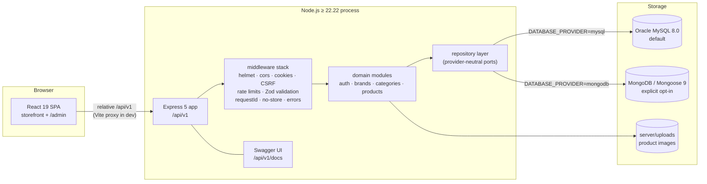
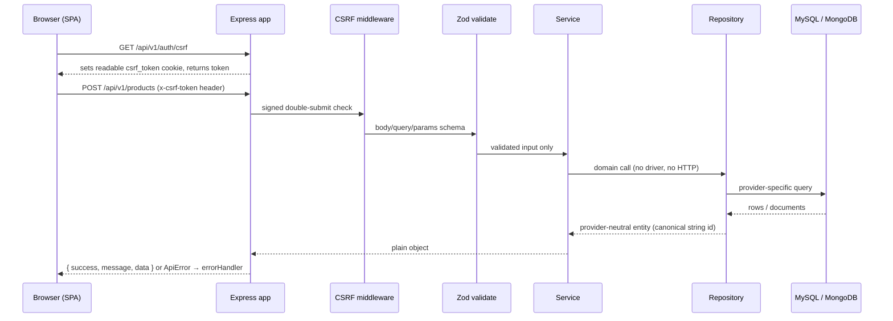
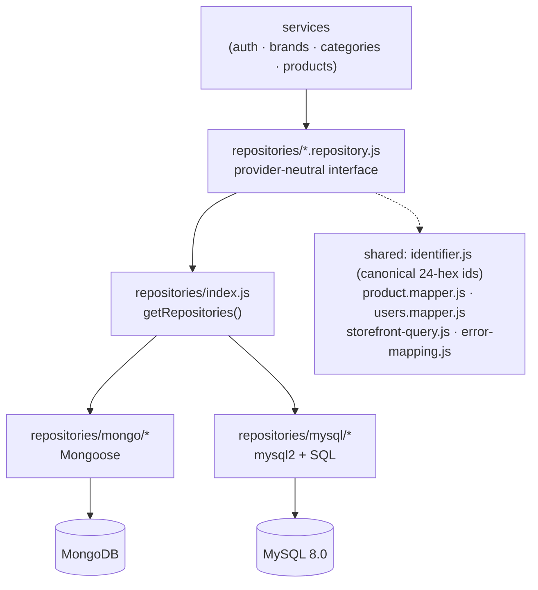
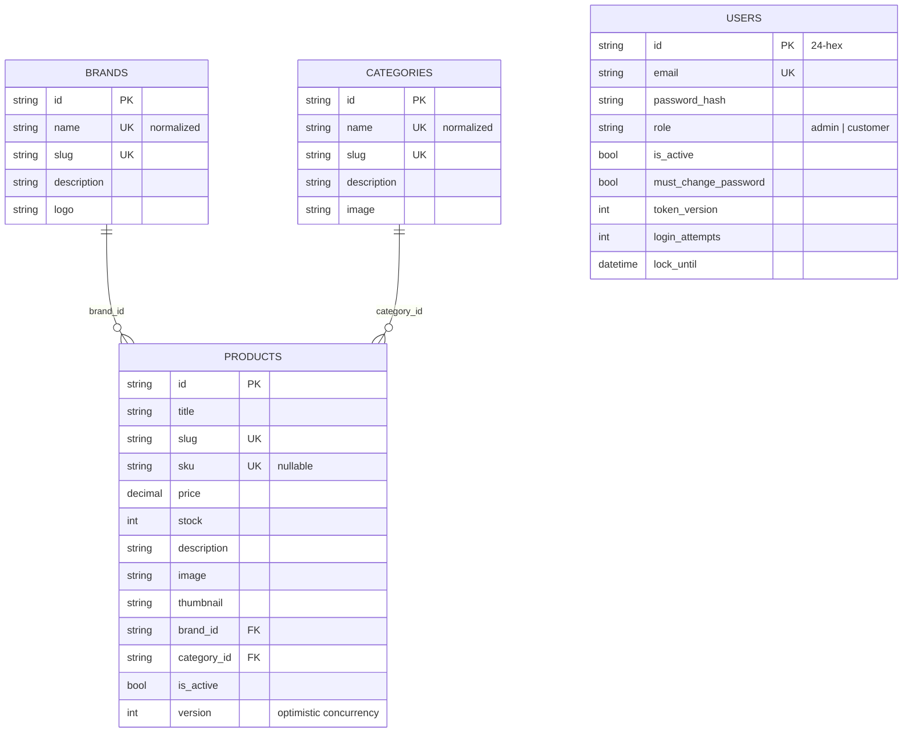
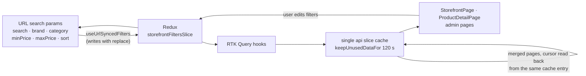
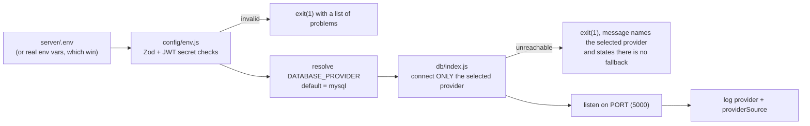

# Architecture

> **Status of this document.** Written 2026-11-06 during the documentation consolidation, by
> reading the code (routes, repositories, slices, hooks, configuration). It describes the
> implementation **as it stands today** and is the authoritative description, superseding the
> descriptive sections of the historical phase reports. It reports no test results — see
> [`../verification/README.md`](../verification/README.md) for what was actually executed and
> when.

---

## 1. Shape of the system

One deployable REST API, one single-page app, one repository. No microservices, no message
broker, no server-side rendering, no container requirement.



Two facts explain most of the design decisions in the reports:

1. **The API is provider-neutral.** Domain code never touches a driver; it talks to repository
   interfaces that have a MongoDB implementation and a MySQL implementation. The API contract
   is intended to be byte-identical across the two, which is what the contract-parity audit and
   CI job assert.
2. **The SPA talks to a relative URL.** `/api/v1` and `/uploads` are relative, proxied by Vite
   in development, so cookies and CSRF stay first-party and the same bundle works behind any
   host.

---

## 2. Repository layout

```
catalogue-platform/            npm workspaces: server, client
├── server/                    Express 5 API (ESM, no transpiler)
│   ├── src/
│   │   ├── app.js             helmet, cors, cookie parser, JSON, static /uploads, no-store, routes
│   │   ├── server.js          bootstrap: env validation → DB connect → listen → graceful shutdown
│   │   ├── shutdown.js        SIGTERM/SIGINT: stop accepting, drain, close pool/mongoose
│   │   ├── routes/index.js    the only file that knows the URL layout; /health + routeMounts
│   │   ├── config/            env.js (Zod + custom secret checks), db.js, seed.js, swagger.js
│   │   ├── constants/         HTTP codes, roles, limits, DEFAULT_ADMIN
│   │   ├── db/                index.js (provider selection + state), mongo/, mysql/, migrate/
│   │   ├── repositories/      ports + mongo/ + mysql/ implementations, mappers, shared queries
│   │   ├── modules/           auth · brands · categories · products
│   │   │   └── {model,validation,service,controller,routes}.js
│   │   ├── middlewares/       auth, csrf, validate, multer, noStore, notFound, errorHandler,
│   │   │                      rateLimiter, requestId, sanitize
│   │   └── utils/             ApiError, apiResponse, cursor codec, slugify, sku, image pipeline, logger
│   ├── scripts/               setup, dev, dev-mongo, e2e-server, reset-admin, steps, with-env
│   ├── tests/                 unit · integration · contracts · fixtures · globalSetup
│   └── uploads/               runtime image storage (git-ignored except .keep)
├── client/                    React 19 + RTK Query SPA (Vite 8 / Rolldown)
│   └── src/
│       ├── api/               apiSlice.js (the single RTK Query slice), baseQuery.js (CSRF retry)
│       ├── app/               store.js, hooks.js (typed-ish app hooks)
│       ├── features/          authSlice, storefrontFiltersSlice, paginationSlice, uiSlice
│       ├── components/        layouts, guards, tables, filters, cards, modal, toaster, grid
│       ├── pages/             StorefrontPage, ProductDetailPage, LoginPage, ChangePasswordPage,
│       │                      NotFoundPage, admin/{Dashboard,Products,ProductForm,Brands,Categories}
│       ├── hooks/             debounce, infinite scroll, virtual grid, scroll restoration,
│       │                      URL↔filter sync, listing depth guard, media query, unsaved changes
│       └── styles/            design tokens + component CSS (hand-written, no UI kit, no CDN)
├── e2e/                       Playwright specs + auth.setup.js + support/auth.js + fixture image
├── audit/                     audit harnesses + golden API-contract snapshot + generated output
├── docs/                      this documentation tree
└── .github/workflows/ci.yml   5 CI jobs (never executed in this workspace — see verification)
```

---

## 3. Server: how a request travels



Key properties, all visible in the code:

| Concern                     | Implementation                                                                                                                                                                                             |
| --------------------------- | ---------------------------------------------------------------------------------------------------------------------------------------------------------------------------------------------------------- |
| **URL layout**              | Everything is mounted in `server/src/routes/index.js` (`routeMounts`) — modules never know each other's paths.                                                                                             |
| **Error model**             | Controllers are plain `async` functions; Express 5 forwards rejected promises to the single `errorHandler`, which shapes `ApiError` and redacts internals in production. No `asyncHandler` wrapper exists. |
| **Validation**              | Zod schemas per module, applied by the `validate` middleware to `body`/`query`/`params` before a service is called.                                                                                        |
| **Auth**                    | JWT in an httpOnly cookie; `token_version` invalidates every session on password change; login attempts + `lock_until` implement lockout; `mustChangePassword` gated by `enforcePasswordRotation`.         |
| **CSRF**                    | Signed double-submit: readable `csrf_token` cookie + `x-csrf-token` header on unsafe methods; the client retries once after a `CSRF_*` answer.                                                             |
| **Rate limiting**           | Global limiter plus dedicated `loginLimiter` and `uploadLimiter`.                                                                                                                                          |
| **No stale reads for JSON** | `noStoreDynamic` (public product JSON, so Back/Forward cannot show a superseded page) and `noStorePrivate` (admin) are scoped to routers; `/uploads` images keep long-lived immutable caching.             |
| **Observability**           | `requestId` correlation, structured JSON logs, `GET /api/v1/health` answering `503` + `database: "disconnected"` when the provider is lost (deliberately no crash-loop).                                   |
| **API docs**                | Swagger UI at `/api/v1/docs`, raw spec at `/api/v1/docs.json`; a test walks the real router tree so the spec cannot drift from the mount table.                                                            |

### 3.1 Mounted surface

| Base path                | Routes                                                                                                                                                                                                        |
| ------------------------ | ------------------------------------------------------------------------------------------------------------------------------------------------------------------------------------------------------------- |
| `/api/v1/health`         | `GET` — status, uptime, database state, environment                                                                                                                                                           |
| `/api/v1/auth`           | `GET /csrf`, `POST /login`, `POST /register`, `POST /logout`, `GET /me`, `POST /change-password`                                                                                                              |
| `/api/v1/brands`         | list · get · create · update · delete (writes require admin)                                                                                                                                                  |
| `/api/v1/categories`     | list · get · create · update · delete (writes require admin)                                                                                                                                                  |
| `/api/v1/products`       | `GET /` (cursor-paginated storefront listing), `GET /:id` (active products only)                                                                                                                              |
| `/api/v1/admin/products` | list (offset-paginated) · get · create (multipart) · put · patch · `patch /:id/stock` · delete · `post /maintenance/sweep-orphans` — all behind `authenticate`, `authorize(admin)`, `enforcePasswordRotation` |

> `POST /auth/register` creates a **customer-role** account and is API-only: no screen in the
> SPA calls it (the `register` mutation exists in the slice but is unused). See the limitations
> section of the root README.

---

## 4. Repository pattern and provider parity



- The **identifier contract** is the load-bearing piece: both providers expose 24-hex string
  ids, so a Mongo `ObjectId` and a `CHAR(24)` primary key are interchangeable at the edge.
- **Query semantics** are re-implemented per provider but constrained by a shared
  `storefront-query.js` so filtering/sorting/pricing behave identically; `error-mapping.js`
  keeps duplicate-key and not-found errors provider-independent.
- **Mappers** guarantee the _same JSON keys_ on both providers — the basis of the
  byte-identical contract snapshot.
- One **documented divergence**: `searchMode=text` does not stem on MySQL (Phase 4/6 reports).
  It is documented, not hidden.

The corresponding MySQL schema lives in `server/src/db/mysql/migrations/` (`001_init.sql`,
`002_categories_image_nullable.sql`), with matching `*.down.sql` files; MongoDB shapes live in
`server/src/modules/*/model.js`.

### 4.1 Data model



Both providers enforce: unique brand/category name (normalized) and slug, unique product slug
and nullable unique SKU, and referential integrity from product → brand/category (delete of an
in-use taxonomy entry is refused rather than cascading).

---

## 5. Client: state, data, and the URL



Rules the code follows:

| Rule                                                                                                                                                                                              | Where                                                              |
| ------------------------------------------------------------------------------------------------------------------------------------------------------------------------------------------------- | ------------------------------------------------------------------ |
| **One API slice.** Every request goes through `client/src/api/apiSlice.js`; there is no second data layer and no `fetch` in components.                                                           | `api/`                                                             |
| **Server data lives in RTK Query only.** Redux holds what the server cannot own: session mirror, filter intent, pagination tokens for admin tables, toasts.                                       | `app/store.js`, `features/`                                        |
| **Relative base URL + CSRF retry.** `baseQuery.js` attaches the token, refreshes once and replays on `CSRF_*`.                                                                                    | `api/baseQuery.js`                                                 |
| **Filters are mirrored into the URL both ways**, so a shared link reproduces the view and Back from a detail page returns to the same filtered grid.                                              | `hooks/useUrlSyncedFilters.js`                                     |
| **Pagination is not in the customer URL.** Depth is owned by the cache; `stripPagination` removes any `page` parameter that arrives from a bookmark or an older link.                             | `hooks/useListingDepth.js`                                         |
| **Long lists are windowed, not dumped.** The grid virtualizes rows and appends the next cursor page when the shopper approaches the bottom.                                                       | `hooks/useVirtualGrid.js`, `hooks/useInfiniteScroll.js`            |
| **Scroll and depth survive navigation**, keyed by the filter set, so appending a page does not re-scroll.                                                                                         | `hooks/useScrollRestoration.js`, `StorefrontPage.jsx`              |
| **Guards are routing-level.** `ProtectedRoute` distinguishes "not authenticated" from "must rotate password" from "not an admin"; `SessionBootstrap` resolves the session once above every route. | `components/ProtectedRoute.jsx`, `components/SessionBootstrap.jsx` |

### 5.1 Two pagination contracts, on purpose

| Consumer                            | Contract                                                                                                                                                                    | Why                                               |
| ----------------------------------- | --------------------------------------------------------------------------------------------------------------------------------------------------------------------------- | ------------------------------------------------- |
| Storefront (`GET /api/v1/products`) | **cursor**: `{ nextCursor, hasNextPage, limit, sort, count }`; cursors are bound to the sort/filter set that minted them (`CURSOR_SORT_MISMATCH`, `CURSOR_FILTER_MISMATCH`) | inserting a product cannot shift a shopper's page |
| Admin tables                        | **offset**: `{ page, limit, total, totalPages, hasNextPage, hasPrevPage }`                                                                                                  | staff need to jump to a specific page             |

### 5.2 Concurrency without transactions

- **Stock** changes use guarded single-document updates (`$inc` with `$gte` / conditional
  `UPDATE … WHERE stock >= ?`), so no multi-document transaction is required.
- **Product edits** are optimistic: the client sends the row `version`, a mismatch answers
  `409 STALE_RESOURCE` instead of overwriting a colleague's change.
- Because of that, MongoDB can run on a standalone `mongod`; the capability probe still reports
  `transactions: false` there, and `REQUIRE_TRANSACTIONS=true` makes that a startup failure for
  deployments that want to insist on a replica set.

---

## 6. Uploads

`multipart/form-data` → `middlewares/multer.js` (size limit, single field, MIME filter) →
`utils/image pipeline` (sniff the bytes, re-encode with **sharp**, emit a 300 px thumbnail,
strip metadata, reject polyglot/mislabelled files) → written under `server/uploads/products/` →
served statically from `/uploads` with an immutable cache policy. The stored path is what the
product row records; deleting a product removes its files, deleting a file that no product
references is what `POST /api/v1/admin/products/maintenance/sweep-orphans` cleans up.

---

## 7. Configuration and boot order



- `server/.env` is the only file read (dotenv does not override real environment variables —
  that is how the `npm run dev:mysql` / `dev:mongodb` launchers force a provider without
  editing files).
- `npm run setup` creates `server/.env` from `.env.example` and generates a fresh
  `JWT_SECRET`; a secret that still contains the placeholder is rejected at boot, so a clone
  cannot start with the example secret.
- Validation refuses weak/placeholder secrets, `localhost` `FRONTEND_URL` in production, and
  invalid provider values.

---

## 8. Cross-cutting decisions worth knowing before changing code

1. **No `asyncHandler`.** Express 5 handles rejected promises; adding a wrapper would create two
   error paths.
2. **No second API slice and no `fetch` in components.** A new endpoint is a builder entry in
   `apiSlice.js` plus tags, never a parallel data layer.
3. **Tags are the invalidation contract.** Product-affecting taxonomy mutations invalidate the
   product list where specificity is not justified; mutations invalidate only after success.
4. **The provider is configuration, not a code branch.** A behaviour that differs per provider
   must be expressed inside the repository implementations, not in services.
5. **The URL is user-facing state, the cache is internal state.** Anything a shopper can share
   belongs in the URL; anything only the cache can restore (loaded page depth, cursors) must not
   be.

## 9. Where the evidence lives

| Question                                                    | Document                                                     |
| ----------------------------------------------------------- | ------------------------------------------------------------ |
| why the repository split happened, phase by phase           | [`../implementation/README.md`](../implementation/README.md) |
| how the two providers are configured, operated and migrated | [`../database/README.md`](../database/README.md)             |
| what was executed, what was skipped, what is unverified     | [`../verification/README.md`](../verification/README.md)     |
